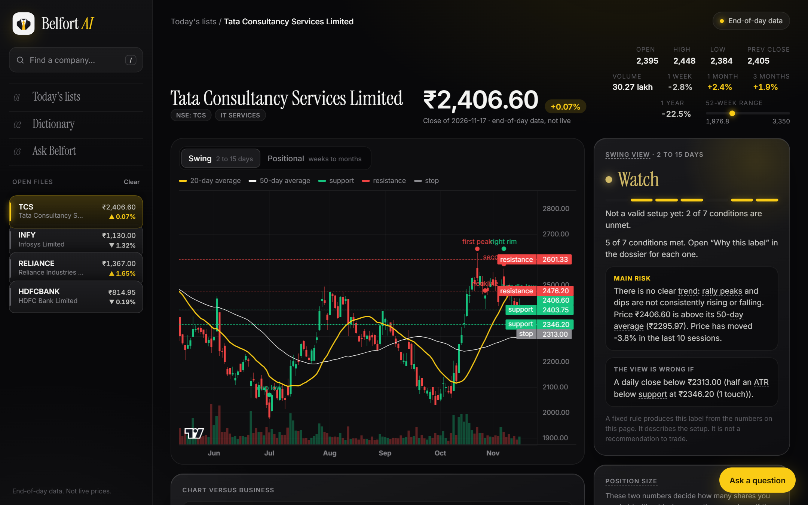
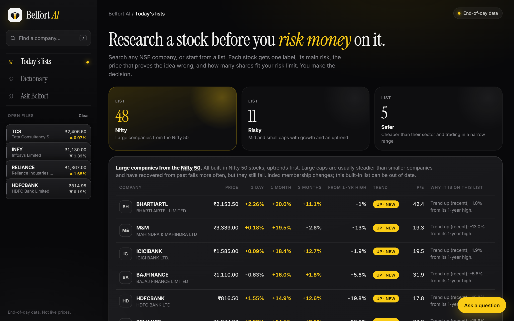
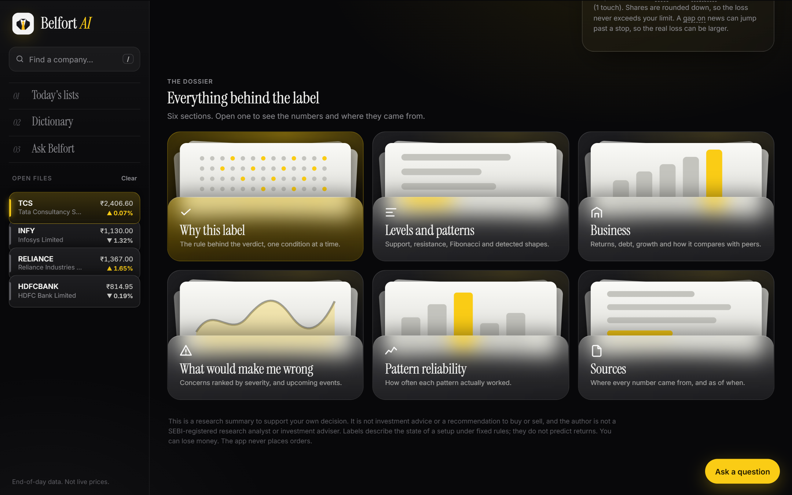
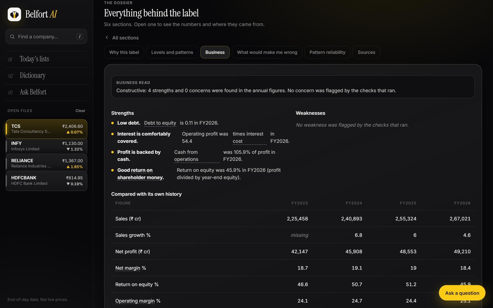
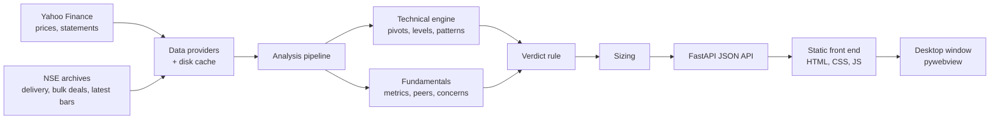

<div align="center">


# Belfort <em>AI</em>

**A research desk for Indian stocks. One label, one risk, one invalidation price.**

[](https://www.python.org/)
[](https://fastapi.tiangolo.com/)
[](#testing-and-backtest)
[](LICENSE)
[](#roadmap)

[Landing page](https://sarthakviche.github.io/belfort-ai/) · [Quick start](#quick-start) · [How it works](#how-the-label-works) · [Roadmap](#roadmap)

<br>



</div>

<br>

## Overview

Belfort AI turns raw NSE price and company data into a structured, sourced read on a single stock for **swing** and **positional** trading. Instead of a wall of indicators, every stock gets:

- **One label** from a fixed, testable rule: *Setup valid*, *Watch*, *Avoid*, or *Insufficient data*.
- **The main risk**, written in plain language from the numbers on the page.
- **The invalidation price**: the level at which the idea is wrong and the reason for the trade is gone.
- **A position size** for your own capital and risk-per-trade, rounded down so a stopped-out loss never exceeds your limit.

The label is produced by deterministic code, not by a language model. Every figure shows its source and date, and anything that could not be fetched is shown as *missing, with the reason* rather than guessed.

> Belfort AI never places orders and does not predict returns. It is an educational research tool. See the [disclaimer](#disclaimer).

<br>

## Screens

<table>
<tr>
<td width="50%"><br><sub><b>Today's lists.</b> Three rule-built screens (Nifty, Risky, Safer) with the criteria shown above each table.</sub></td>
<td width="50%"><br><sub><b>The dossier.</b> Six sections behind every label: rule, levels, business, risks, pattern reliability, sources.</sub></td>
</tr>
<tr>
<td colspan="2"><br><sub><b>Business read.</b> Returns, debt, growth, valuation against sector peers, and the latest quarter.</sub></td>
</tr>
</table>

<br>

## Features

| | |
|---|---|
| **Rule-based verdict** | A single label per stock and trading style, computed by a fixed rule in [`app/analysis/verdict.py`](app/analysis/verdict.py). Same inputs, same label. |
| **Two trading styles** | *Swing* (2 to 15 days) and *Positional* (weeks to months), each with its own moving averages, pivot sensitivity, stop limits and results-date handling. |
| **Technical engine** | Swing pivots, support and resistance with touch counts, Fibonacci retracements, RSI, MACD, ATR, volume confirmation. |
| **Pattern detection** | Double tops and bottoms, head and shoulders (and inverse), cup and handle, rising and falling trend lines. Shown on the chart but **not** part of the label. |
| **Pattern reliability** | A backtest shows how often each detector finds textbook shapes, how often it fires on random noise, and how real signals compared with a random-entry baseline. |
| **Business check** | Annual statements, return on equity, debt, growth, P/E against sector peers, latest quarter, and a ranked list of concerns. It can lower a label but never raise it. |
| **Position size calculator** | Your capital, your risk percentage, your own stop if you prefer. Shares are rounded down. |
| **Dictionary** | Every term is defined once and underlined where it appears, with a hover explanation. |
| **Ask Belfort (optional)** | An explainer chat powered by Google Gemini with **your own API key**. It explains terms and labels; replies containing promise-style wording are blocked. |
| **Open files** | Recently researched stocks are kept in a sidebar drawer for one-click return. |
| **Runs locally** | Your machine, your data. No account, no hosting. |

<br>

## How the label works

| Label | Rule |
|---|---|
| **Setup valid** | Uptrend for the chosen style, price at a sensible entry area, not stretched, stop within the style's limit, reward at least 1.5 times risk, no results due (swing), and no serious business concern. |
| **Watch** | Any of those unmet. The page lists exactly which ones. |
| **Avoid** | Downtrend for the style, or a serious business concern. |
| **Insufficient data** | Fewer bars than the style needs. |

The business side can **lower** a label, never raise it. Chart patterns are displayed but are deliberately excluded from the rule: their measured predictive power on liquid stocks is weak, and the app shows that evidence rather than hiding it.

<br>

## Architecture



```
belfort.py             Desktop launcher: starts the backend and opens the app window
app/
  main.py              FastAPI routes, static files, optional access codes
  config.py            Style presets, thresholds, banned wording, disclaimer
  screens.py           Rule-built home lists
  chat.py              Optional Gemini explainer (bring your own key)
  glossary.py          Dictionary terms
  analysis/
    pipeline.py        Orchestrates one analysis end to end
    structure.py       Trend and swing structure
    pivots.py          Pivot detection
    patterns.py        Pattern detectors
    indicators.py      RSI, MACD, ATR
    fundamentals.py    Metrics, peer comparison, concerns
    verdict.py         The label rule
    sizing.py          Position size
    explain.py         Sentences generated from numbers; banned-phrase filter
  backtest/            Synthetic pattern tests and real-history evaluation
  data/                Providers, TTL disk cache, symbol universe
  static/              Front end (no build step)
scripts/               Backtest runner, desktop shortcut
tests/                 42 tests covering the engine and the API
```

**Design choices**

- **No build step.** A plain static front end served by FastAPI; nothing to compile.
- **Provider interface.** Data comes through a small class, so a licensed feed or broker API can replace Yahoo by implementing the same methods.
- **Explanations are generated in code** from the computed numbers. No invented figures, and the wording is testable.
- **The chart is a view of the data, never an input** to the verdict.

<br>

## Quick start

### Windows app (recommended)

1. Install [Python 3.12](https://www.python.org/downloads/).
2. Clone the repository and double-click **`run.bat`**. The first run creates a virtual environment and installs dependencies.
3. Optional: create a desktop shortcut with the Belfort AI icon.

```powershell
powershell -ExecutionPolicy Bypass -File scripts\create_shortcut.ps1
```

Belfort AI opens in its own window and the backend runs inside it. Closing the window stops the server.

> Requires Windows 10 or 11 with the Microsoft Edge WebView2 runtime (included with Windows 11).

### From source (any platform)

```bash
git clone https://github.com/sarthakviche/belfort-ai.git
cd belfort-ai
python -m venv .venv
.venv/Scripts/python -m pip install -r requirements.txt   # macOS/Linux: .venv/bin/python
.venv/Scripts/python -m uvicorn app.main:app --port 8765
```

Then open <http://localhost:8765>, search a company such as `TCS`, choose a style, and enter your capital and risk per trade.

### Configuration

Copy `.env.example` to `.env`. Everything is optional.

| Variable | Purpose |
|---|---|
| `GEMINI_API_KEY` | Enables the *Ask Belfort* chat. Get a free key from [Google AI Studio](https://aistudio.google.com/apikey). Without it, the rest of the app works unchanged. |
| `GEMINI_MODEL` | Which Gemini model the chat calls. |
| `ACCESS_CODES` | Comma-separated codes that every request must present. A simple gate for sharing, not an account system. |

When the chat is used, the question and a text summary of the report on screen are sent to Google. Your key stays on your machine.

<br>

## Data sources

| Data | Source | Status |
|---|---|---|
| Daily prices and volume | Yahoo Finance (`yfinance`), latest sessions filled from NSE end-of-day files | Working |
| Annual statements, P/E, peers | Yahoo Finance | Working, about four years |
| Delivery percentage, bulk deals | NSE public archive files | Working, best effort |
| Next results date | Yahoo Finance calendar | Often missing |
| Promoter pledge, order book depth, announcements | None | Shown as missing, with the reason |

All prices are **end-of-day, not live**. Each number in the app carries its source and as-of date.

<br>

## Testing and backtest

```bash
.venv/Scripts/python -m pytest -q                 # 42 tests
.venv/Scripts/python scripts/run_backtest.py      # rewrites data/pattern_stats.json
```

The backtest has two parts. **Synthetic**: computer-drawn textbook shapes with noise plus random charts, to measure how well each detector finds its pattern and how often it fires on noise. **Historical**: real signals on large NSE stocks compared against a random-entry baseline over a fixed horizon. Both are shown in the app's *Pattern reliability* section.

<br>

## Roadmap

- [x] Rule-based verdict, technical engine, business check, position sizing
- [x] Redesigned interface and dossier
- [x] Desktop launcher (one click, own window)
- [ ] **Paper trading.** Practise with virtual points (1 rupee = 1 point), record a prediction, and review how it played out over time, in a section fully separate from research.
- [ ] Packaged Windows installer, so Python is not required
- [ ] Licensed data feed option

<br>

## Known limitations

- Yahoo data is unofficial and limited to about four years of statements, so the concerns list is validated on synthetic cases, not on real historical failures.
- Index membership changes; the built-in Nifty list can fall out of date.
- Some fields (results date, delivery, bulk deals) are best effort and may be missing.
- Pattern detectors have no human-labelled ground truth.

<br>

## Disclaimer

Belfort AI is an educational and research project. It is **not investment advice or a recommendation to buy or sell any security**, and its author is not a SEBI-registered research analyst or investment adviser. Labels describe the state of a setup under fixed rules; they do not predict returns. You can lose money. The software never places orders.

<br>

## License

Released under the [MIT License](LICENSE).

<div align="center">
<br>
<sub>Belfort <em>AI</em></sub>
</div>
